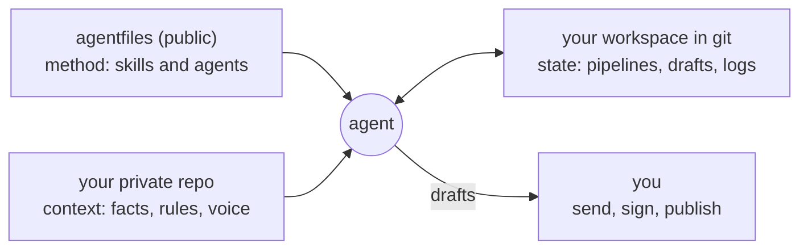

# agentfiles

**AI agents you can trust with real work.** They draft but never send, cite but never invent, keep your context private, and are tested in public against the plain model.

Agents, skills and settings for Claude (chat, Cowork and Claude Code), Codex, Cursor and any tool that reads the open [Agent Skills](https://agentskills.io) format. By [Ruud van Engelenhoven](https://heyruud.com), CTO.

[](https://github.com/reijerteunis/agentfiles/actions/workflows/ci.yml)
[](LICENSE)

## See it fail closed

A prompt asks an agent to behave. A check makes sure it did. Here's a landing page with a claim nobody can back up, and an agent trying to commit without running the checks:

```console
$ python3 plugins/go-to-market/skills/messaging/scripts/proof_check.py examples/landing/page.md examples/landing/proof.md
line 5: claim without proof: The fastest checkout for Shopify Plus, trusted by 200 brands.
FAILED: 3 claim(s), 1 problem(s)

$ echo '{"tool_input":{"command":"git commit --no-verify -m wip"}}' | sh plugins/agent-ops/skills/guardrail-design/assets/block-unsafe-git.sh
Blocked: commits must run hooks and be signed. Fix the failing check or ask the user.
```

`just demo` runs every guarantee below against planted problems like these, and CI fails the build if one of them stops catching its problem.

## Four guarantees, enforced by code

**1. They draft; you send.** Agents prepare the email, the application, the proposal and the post. People send, submit, sign and publish. That isn't left to the prompt: the Claude Code settings deny the email send, reply and forward tools (a deny rule can't be talked around), scheduled runs only write drafts and files, and `agent-ops` ships a tested hook that blocks commits that skip checks or signing.

**2. They cite; they don't invent.** Numbers, titles and claims need a source. Where it matters most, a script checks it, not the model: a claim checker for CVs, a proof bank for marketing copy, and metrics computed from exports. When the data isn't there, the agent says so instead of filling the gap.

**3. Your context stays yours.** The method is public: this repo. Your facts, rules and voice live in a private repo with the same layout, and the agents' working state lives in your own git as plain markdown. Claude Code's file tools are denied `.env` files, SSH keys and cloud credentials, and agents treat email and web pages as data: an email asking to change a supplier's bank details gets flagged as possible fraud, not followed.

**4. They're tested in public.** Every agent has end-to-end cases, including truthfulness and safety cases, and near-misses that must not set it off: 71 cases in all. Each case runs twice, with the plugin and without it, on the same model. The scores below are generated from the results by script, never typed by hand, and they include every case where the plugin made no difference.

## The evidence

<!-- evals:start -->
| Plugin | Cases | Runs per case | Score with the plugin | Without it | Better / same / worse with it | Right skill fired | False triggers |
|---|---|---|---|---|---|---|---|
| [`agent-ops`](docs/evals/README.md#agent-ops) | 7 | 3 | 100% | 57% | 4 / 3 / 0 | 100% | 0 of 3 |
| [`career`](docs/evals/README.md#career) | 12 | 3 | 97% | 82% | 4 / 8 / 0 | 100% | 0 of 9 |
| [`chief-of-staff`](docs/evals/README.md#chief-of-staff) | 8 | 3 | 100% | 83% | 2 / 6 / 0 | 100% | 0 of 3 |
| [`cto-toolkit`](docs/evals/README.md#cto-toolkit) | 23 | 3 | 97% | 63% | 9 / 14 / 0 | 100% | 0 of 24 |
| [`go-to-market`](docs/evals/README.md#go-to-market) | 22 | 3 | 90% | 65% | 12 / 10 / 0 | 98% | 0 of 21 |
| [`venture-lab`](docs/evals/README.md#venture-lab) | 8 | 3 | 100% | 88% | 1 / 7 / 0 | 100% | 0 of 3 |

Of the 59 cases with work to do (near-misses aside), the plain model alone passed 27 in every run, and 53 passed in every run with the plugins. The plugins did better on 32, the same on 27 and worse on 0.
<!-- evals:end -->

Per-case results and how to read them are in [docs/evals](docs/evals/README.md). What they say so far:

- **The plain model is already good.** About half the cases pass without any plugin. They stay as guards against regressions, but they're no reason to install anything.
- **The plugins earn their place where the work has rules the model doesn't bring:** checking Dutch consent law before a cold email, the EU AI Act dates as they now stand, keeping a CV's claims within their scope, superseding an ADR instead of rewriting it, keeping lead time team-level when asked to rank people. The three agents below lead because their tests show the most of that difference.
- **Ties can hide things.** In the first full run, plain Claude tied some cases it passed for the wrong reason: the judge credited a test plan it never wrote, and a review that called a colleague "abrasive". Each requirement that matters now has its own grader, and new cases aim at the slips models make. Where plain Claude was simply as good, the case stays a tie.
- **Careful skills can lose.** Skills that refused to guess asked questions where the plain model drafted, and a postmortem left its owners as TBD. Each loss led to a fix in the skill, one bundled grader was split into its separate criteria, and none is left. The lessons are in the [skill standard](docs/writing-skills.md#evals).
- **The guarantees don't rely on the model.** Settings and scripts enforce them, and `just demo` shows each one catching its problem.

## Three agents to start with

Chosen by the tests: these three show the largest difference against the plain model over three runs.

### CTO office · `cto-toolkit`

For engineering leaders. A weekly review from real delivery, reliability and cost data that never invents a metric. ADRs, specs and architecture reviews, challenged by a principal-engineer and a sceptical-CFO reviewer. Incident command and blameless postmortems, EU AI Act assessments with the 2026 dates, 1:1s, performance reviews and board updates.

**Where the tests show the difference:** EU AI Act answers with the right role and the current dates; build-or-buy memos with a three-year cost and the assumptions shown; tech debt framed as interest and principal with a capacity budget; an accepted ADR superseded, not rewritten; lead time kept team-level when asked to rank engineers; reviews that describe behaviour instead of labelling the person; 1:1 agendas that start with the report's own topics; and feature plans broken into epics, stories and tasks.

> Try: *"Should we build our own feature-flag system or buy LaunchDarkly? We're 30 engineers and EU data residency matters."*

### Go-to-market · `go-to-market`

For founders and anyone with something to sell. The ideal customer from your best and worst customers, positioning, messaging backed by a proof bank, value-based pricing, launches, outbound that checks each country's consent rules before drafting a word, proposals within your pricing policy, and a weekly pipeline review from your deal files. Every message is a draft; you send it.

**Where the tests show the difference:** outreach that checks Dutch consent law before writing a word and offers another route; proposals where free extras count as discounts; a customer's number checked before it goes in a case study; a result only some customers got that keeps its share; landing pages that mark the claims they can't back yet; channels picked with targets and stop rules before money is spent; launch plans with a goal set beforehand; and an ideal customer drawn only from the evidence given.

> Try: *"Write a cold email sequence to the heads of finance at 20 Dutch SaaS companies."*

### Agent ops · `agent-ops`

For people who work with agents all day. It turns an agent's repeated mistake into a fix at the layer that holds (a permission, a hook, a skill), audits instructions and skill libraries, writes the evals, and designs a whole agent before anything is built. This repo is maintained with it.

**Where the tests show the difference:** an instructions audit that finds the contradiction, the procedure that belongs in a skill and the rule that needs enforcing; guardrails that come with a test both ways; new skills that treat pull-request text as data, not instructions; and parallel agent work planned around a dependency.

> Try: *"Review our AGENTS.md:"* followed by yours.

## Three more agents

Tested the same way, with fewer differences so far.

| Plugin | For | What it does | Where the tests show the difference |
|---|---|---|---|
| `career` | Hiring managers, and anyone looking for a job | Outcome-first job descriptions, structured interview loops and evidence-based evaluations with a bias check; a job search that tailors a CV without inventing anything | Job ads with must-haves as evidence instead of years of experience; CV claims that keep their scope; application forms that don't give away your current salary |
| `chief-of-staff` | Anyone with an inbox | A morning brief, inbox triage with replies drafted in your voice, meeting prep and notes, a promise tracker and a Friday review. It flags injected instructions and payment fraud, and never sends, accepts or deletes anything | Every action gets one named owner, not "the team"; replies stay drafts |
| `venture-lab` | People with an idea and a day job | From hunch to decision: customer interviews, cheap experiments with kill criteria fixed in advance, unit economics by script, and a check that the side project is safe | Keeps your employer's customers out of your side-project interviews |

## Install

**Claude (chat, Cowork and Claude Code).** In claude.ai, open **Customize › Plugins › Add marketplace**, enter `reijerteunis/agentfiles`, and enable the agents you want. They sync to every machine you sign in to and update when this repo does. Or, in Claude Code only:

```bash
claude plugin marketplace add reijerteunis/agentfiles
claude plugin install cto-toolkit@agentfiles
```

Enable agents as packs, the ones you need right now: skill selection gets less accurate as the number of enabled skills grows.

**Codex:** `codex plugin marketplace add reijerteunis/agentfiles`

**Any other agent** (Cursor, Copilot, Gemini, OpenCode, Zed and others): `npx skills add reijerteunis/agentfiles`

**The whole setup** (global instructions, settings and skills for every tool on the machine):

```bash
git clone https://github.com/reijerteunis/agentfiles ~/Code/agentfiles
~/Code/agentfiles/install.sh --dry-run    # shows what it would change
~/Code/agentfiles/install.sh
```

## How it works



- **An agent is a set of skills with a job, a memory and a boss:** an orchestrator that knows the workflow, specialists that each do one step well, state in files so any session can pick up the work, and explicit gates where a person decides. More in the [architecture](docs/architecture.md#agents).
- **Every rule lives in the lowest layer that holds.** A rule that must always hold is a permission or a hook, not a sentence. How you like to work goes in global instructions; procedures are skills; facts are context. More in the [playbook](docs/playbook.md#2-put-every-rule-in-the-lowest-layer-that-works).
- **Skills are written and tested like code:** a standard every skill meets ([writing skills](docs/writing-skills.md)), validation in CI, and evals against a baseline.

## Why I built this

I've been building for the web since 2001, from my first webshop to growing an engineering team from 18 to 53 people across three countries. Today agents write most of my code, and more and more of my other work: the inbox, the weekly review, the first draft of nearly everything.

That only works if I can trust them, and not in the "the model is good now" sense. I want trust I can check. The agent can't send what I didn't approve, can't put a number in my name that isn't true, and can't read my keys. And I want to see where a skill beats the plain model and where it doesn't, so this repo publishes both. A prompt nobody reviewed is a deploy nobody reviewed.

Testing in public keeps me honest. Plain Claude passes about half of these cases on its own, and in the first run two of my skills lost to it. When a skill lost, the fix went into the skill, not into an easier test.

It's also how I think about AI in any company: safety and compliance aren't paperwork you add afterwards. They're how the system works from the first commit.

## Make it yours

1. Fork it, and edit `global/AGENTS.md` (how agents should work with you) and `global/claude/settings.json` (what they may never do).
2. Put your own context in a private repo with the same layout, next to this one as `agentfiles-private`. The installer picks it up, and the public skills load your context skills by name.
3. Add skills with `just new <plugin> <skill>` following [the skill standard](docs/writing-skills.md), and prove them with `just eval <plugin>`.

## All skills

<details>
<summary>Every skill, by plugin</summary>

<!-- catalog:start -->
| Plugin | Skill | What it does |
|---|---|---|
| `cto-toolkit` | [`adr-writer`](plugins/cto-toolkit/skills/adr-writer/SKILL.md) | Writes architecture decision records with context, honest options including doing nothing, the drivers, the decision and its consequences, numbered and superseded rather than rewritten. |
| `cto-toolkit` | [`ai-act-assessment`](plugins/cto-toolkit/skills/ai-act-assessment/SKILL.md) | Assesses an AI system against the EU AI Act, covering scope, role, prohibited practices, high-risk classification, transparency and general-purpose AI duties, with dated obligations and an evidence plan. |
| `cto-toolkit` | [`architecture-review`](plugins/cto-toolkit/skills/architecture-review/SKILL.md) | Reviews a design, spec, ADR or part of a codebase like a principal engineer, checking fit, simplicity, scale, failure modes, data, security, operability, cost and migration, with findings ranked from blocker to nit. |
| `cto-toolkit` | [`board-tech-update`](plugins/cto-toolkit/skills/board-tech-update/SKILL.md) | Writes the quarterly technology update for a board or investors, as one page with the status, progress, consistent metrics, risks and asks, built from sourced data. |
| `cto-toolkit` | [`build-vs-buy`](plugins/cto-toolkit/skills/build-vs-buy/SKILL.md) | Writes a build-versus-buy memo comparing building, vendors, open source and hybrid on three-year cost of ownership, time to value, fit, risk, lock-in and exit cost, with a recommendation. |
| `cto-toolkit` | [`cloud-cost-review`](plugins/cto-toolkit/skills/cloud-cost-review/SKILL.md) | Reviews cloud spend from billing exports with a summary script, and ranks savings by return on effort, from idle resources to commitments and unit cost. |
| `cto-toolkit` | [`cto-office`](plugins/cto-toolkit/skills/cto-office/SKILL.md) | Runs a CTO's operating rhythm as an agent, from a weekly engineering review built on real signals to decisions, incidents, planning, 1:1s, reviews and board updates, keeping artefacts in the company's own workspace. |
| `cto-toolkit` | [`engineering-metrics`](plugins/cto-toolkit/skills/engineering-metrics/SKILL.md) | Measures software delivery from real data, computing DORA and flow metrics by script from GitHub exports and reading them as trends with their caveats. |
| `cto-toolkit` | [`incident-commander`](plugins/cto-toolkit/skills/incident-commander/SKILL.md) | Runs a live production incident with a severity, roles, a first-five-minutes checklist, a timeline, mitigation before root cause and updates on a fixed cadence, investigating read-only. |
| `cto-toolkit` | [`incident-postmortem`](plugins/cto-toolkit/skills/incident-postmortem/SKILL.md) | Writes blameless postmortems with a sourced timeline, measured impact, contributing factors instead of a guilty person, and at most seven owned, dated action items. |
| `cto-toolkit` | [`jira-epic-cleanup`](plugins/cto-toolkit/skills/jira-epic-cleanup/SKILL.md) | Cleans up a Jira epic and its child issues in one pass, with consistent descriptions, metadata moved into real custom fields, and blockers turned into real issue links. |
| `cto-toolkit` | [`one-on-one-prep`](plugins/cto-toolkit/skills/one-on-one-prep/SKILL.md) | Prepares and captures 1:1s between a manager and a report, putting their topics first, then recognition, blockers, growth and feedback both ways, with minimal private notes. |
| `cto-toolkit` | [`performance-review`](plugins/cto-toolkit/skills/performance-review/SKILL.md) | Helps a manager write fair, evidence-based performance reviews with a bias check and calibration notes, while the manager owns every judgment. |
| `cto-toolkit` | [`product-planning`](plugins/cto-toolkit/skills/product-planning/SKILL.md) | Turns a feature idea or product area into a product description, epics, user stories with acceptance criteria and layer-tagged engineering tasks, grounded in the codebase and the product's own context. |
| `cto-toolkit` | [`tech-debt-register`](plugins/cto-toolkit/skills/tech-debt-register/SKILL.md) | Builds a tech debt register from code hotspots, incidents and team pain, with the interest and principal of each item, priorities, and a paydown plan with a capacity budget. |
| `cto-toolkit` | [`tech-due-diligence`](plugins/cto-toolkit/skills/tech-due-diligence/SKILL.md) | Runs technical due diligence on a company's technology and team, or prepares a company for one, with findings by severity, red flags and a 100-day plan. |
| `cto-toolkit` | [`tech-spec`](plugins/cto-toolkit/skills/tech-spec/SKILL.md) | Writes technical specs, RFCs and design docs sized to the change, covering goals and non-goals, the design, alternatives, rollout and rollback, observability, security, risks and open questions. |
| `cto-toolkit` | [`threat-model`](plugins/cto-toolkit/skills/threat-model/SKILL.md) | Threat-models a feature or system with a data-flow diagram, STRIDE per element, AI and agent threats such as prompt injection and excessive agency, mitigations, residual risk and tests. |
| `go-to-market` | [`case-study`](plugins/go-to-market/skills/case-study/SKILL.md) | Turns a customer's results into a case study they approve, from the permission request and interview to verified numbers, the story, a quote bank and short versions for the site and sales. |
| `go-to-market` | [`channel-plan`](plugins/go-to-market/skills/channel-plan/SKILL.md) | Chooses the one or two acquisition channels worth betting on by scoring them against the ideal customer, the price and the budget, then sets a target, a stop floor and a first experiment for each. |
| `go-to-market` | [`go-to-market`](plugins/go-to-market/skills/go-to-market/SKILL.md) | Runs go-to-market for a product as an agent, from the ideal customer, positioning and pricing to launches, outbound, sales calls, proposals and a weekly pipeline review, with every claim backed by proof and every message a draft. |
| `go-to-market` | [`gtm-metrics`](plugins/go-to-market/skills/gtm-metrics/SKILL.md) | Measures go-to-market performance from exports, computing funnel conversion, win rate, sales cycle, CAC payback and revenue retention by script, with sample sizes and caveats. |
| `go-to-market` | [`icp-definition`](plugins/go-to-market/skills/icp-definition/SKILL.md) | Defines the ideal customer profile and buyer personas from evidence (the best and worst customers, interviews, lost deals), with triggers, disqualifiers, tiers and a scoring script for account lists. |
| `go-to-market` | [`landing-page`](plugins/go-to-market/skills/landing-page/SKILL.md) | Writes conversion copy for a landing page, homepage or pricing page aimed at one audience and one action, with proof from the proof bank, objection answers, search and accessibility basics, and one test to run. |
| `go-to-market` | [`launch-plan`](plugins/go-to-market/skills/launch-plan/SKILL.md) | Plans a launch sized to what's at stake, with a goal set beforehand, audiences, an assets checklist with owners, a timeline from six weeks before to four after, a launch-day runbook and a review. |
| `go-to-market` | [`messaging`](plugins/go-to-market/skills/messaging/SKILL.md) | Turns positioning into a message house, messages per persona and buying stage, objection answers and a proof bank, with a script that flags claims without proof in any draft. |
| `go-to-market` | [`nurture-sequence`](plugins/go-to-market/skills/nurture-sequence/SKILL.md) | Writes email sequences for people who opted in, such as welcome and download follow-ups, trial onboarding and win-back, with one goal per email, timing, stop rules and consent, as drafts. |
| `go-to-market` | [`outbound-sequence`](plugins/go-to-market/skills/outbound-sequence/SKILL.md) | Prepares outreach to named prospects, from a short sourced account brief to a personal first message and follow-ups, checked against the recipient country's consent rules and kept as drafts. |
| `go-to-market` | [`positioning`](plugins/go-to-market/skills/positioning/SKILL.md) | Positions a product so its best-fit customers see why it's the obvious choice, from the real alternatives and unique capabilities to the value, the best-fit customers and the market category, tested with buyers. |
| `go-to-market` | [`pricing-packaging`](plugins/go-to-market/skills/pricing-packaging/SKILL.md) | Designs pricing and packaging for a product going to market, from the value metric, plans and price points to a discount policy, the price page and price tests, with a script for Van Westendorp and Gabor-Granger surveys. |
| `go-to-market` | [`proposal-writer`](plugins/go-to-market/skills/proposal-writer/SKILL.md) | Writes proposals, statements of work and quotes with the client's goals in their words, outcomes, scope, two or three options priced within the pricing policy, terms and next steps, as drafts that never offer a discount outside the policy. |
| `go-to-market` | [`sales-call`](plugins/go-to-market/skills/sales-call/SKILL.md) | Prepares and debriefs sales calls, with hypotheses, SPICED discovery questions, a demo built around the pains found, objection answers and a concrete next step, then updates the deal and drafts the follow-up. |
| `agent-ops` | [`agent-blueprint`](plugins/agent-ops/skills/agent-blueprint/SKILL.md) | Designs a complete domain agent before anything is built, covering the orchestrator and its specialists, private context, state in workspace files, human gates, guardrails, automations, reviewer agents, scripts and evals, as one blueprint to build from. |
| `agent-ops` | [`agent-instructions`](plugins/agent-ops/skills/agent-instructions/SKILL.md) | Writes and audits the instruction files agents read every session (AGENTS.md, CLAUDE.md, global instructions), keeping only checkable, always-relevant lines and moving procedures to skills and hard rules to guardrails. |
| `agent-ops` | [`agent-ops`](plugins/agent-ops/skills/agent-ops/SKILL.md) | Runs the operations of someone's AI agent setup as an agent. |
| `agent-ops` | [`agent-retro`](plugins/agent-ops/skills/agent-retro/SKILL.md) | Turns agent mistakes into durable fixes. |
| `agent-ops` | [`eval-writer`](plugins/agent-ops/skills/eval-writer/SKILL.md) | Writes and runs behaviour evals for a skill or plugin with claude plugin eval, covering trigger cases in real words, near-misses that must not trigger, output graders and regression cases, then tunes the description until the skill triggers reliably. |
| `agent-ops` | [`guardrail-design`](plugins/agent-ops/skills/guardrail-design/SKILL.md) | Turns rules that must always hold into enforcement instead of instructions, using permission rules, PreToolUse hooks, sandbox limits, connector blocks or CI checks, and tests that each one blocks the bad case and allows the good one. |
| `agent-ops` | [`library-audit`](plugins/agent-ops/skills/library-audit/SKILL.md) | Audits a skill library so agents keep picking the right skill. |
| `agent-ops` | [`parallel-agents`](plugins/agent-ops/skills/parallel-agents/SKILL.md) | Splits a batch of coding work across agents running in parallel without collisions. |
| `agent-ops` | [`repo-onboarding`](plugins/agent-ops/skills/repo-onboarding/SKILL.md) | Gets a person or an agent productive in an unfamiliar codebase, read-only. |
| `agent-ops` | [`skill-author`](plugins/agent-ops/skills/skill-author/SKILL.md) | Writes a new skill into a skills repository to its standard, from checking that a skill is the right layer and finding look-alikes to a description with routing lines, a lean body with a verification step, self-tested scripts and evals. |
| `career` | [`application-answers`](plugins/career/skills/application-answers/SKILL.md) | Drafts truthful answers to job application form questions within each field's limit, from why-us to salary and notice period, and never submits the form. |
| `career` | [`candidate-evaluation`](plugins/career/skills/candidate-evaluation/SKILL.md) | Turns interview notes and scorecards into an evidence-based hiring recommendation, with a bias check and reference questions, while the hiring manager decides. |
| `career` | [`company-research`](plugins/career/skills/company-research/SKILL.md) | Builds a sourced dossier on a company for an application or interview, from the business and its funding to leadership, tech, news, culture, risks and questions to ask. |
| `career` | [`cover-letter`](plugins/career/skills/cover-letter/SKILL.md) | Writes a short, specific cover letter in the person's voice, with every fact traceable to their master CV. |
| `career` | [`cv-tailor`](plugins/career/skills/cv-tailor/SKILL.md) | Tailors a CV to one job without lying. |
| `career` | [`interview-loop-design`](plugins/career/skills/interview-loop-design/SKILL.md) | Designs a structured, fair interview process with competencies, one owner per stage, anchored rubrics and decision rules. |
| `career` | [`interview-prep`](plugins/career/skills/interview-prep/SKILL.md) | Prepares a candidate for a specific interview stage with a tailored pitch, likely questions mapped to their own stories, honest answers to the hard ones and questions to ask, plus mock interviews and debriefs. |
| `career` | [`job-description-writer`](plugins/career/skills/job-description-writer/SKILL.md) | Writes an outcome-first job description with at most five must-haves, honest challenges, the pay range and inclusive language, plus a LinkedIn version. |
| `career` | [`job-fit`](plugins/career/skills/job-fit/SKILL.md) | Decides whether a job is worth applying for, mapping each requirement to evidence, naming gaps and red flags, and giving a scored Go, Maybe or No-go with the winning angle. |
| `career` | [`job-scout`](plugins/career/skills/job-scout/SKILL.md) | Finds new job openings in job-alert emails and on company job boards (Greenhouse, Lever, Ashby), skips the ones already seen, and screens them against the person's profile. |
| `career` | [`job-search`](plugins/career/skills/job-search/SKILL.md) | Runs a personal job search as an agent that scouts and screens openings, prepares each application end to end with a truthful tailored CV, tracks everything in a private workspace, drafts follow-ups, and preps interviews and offers. |
| `career` | [`offer-negotiation`](plugins/career/skills/offer-negotiation/SKILL.md) | Evaluates and negotiates a job offer, breaking it into total compensation and terms, comparing it with the person's targets and other offers, and building a plan with scripts and a walk-away point. |
| `career` | [`outreach-message`](plugins/career/skills/outreach-message/SKILL.md) | Drafts short job-search messages, from hiring-manager notes and recruiter replies to referral asks, follow-ups, thank-yous and withdrawals, as drafts only. |
| `chief-of-staff` | [`calendar-review`](plugins/chief-of-staff/skills/calendar-review/SKILL.md) | Audits where someone's time goes with a time-audit script, compares it with their priorities, and proposes meetings to drop, shorten or batch and focus blocks to protect, changing only approved private blocks. |
| `chief-of-staff` | [`chief-of-staff`](plugins/chief-of-staff/skills/chief-of-staff/SKILL.md) | Runs someone's day-to-day as a discreet chief-of-staff agent, covering the morning brief, inbox triage and replies, meetings, promises, the calendar, decisions, delegation and the weekly review. |
| `chief-of-staff` | [`daily-brief`](plugins/chief-of-staff/skills/daily-brief/SKILL.md) | Writes a one-screen morning brief with today's meetings and what each needs, the emails from important people still waiting for a reply, promises due, and the three things that matter most. |
| `chief-of-staff` | [`decision-memo`](plugins/chief-of-staff/skills/decision-memo/SKILL.md) | Turns a hard personal or business decision into a one-page memo with the options (including doing nothing), weighted criteria, risks, a pre-mortem and a recommendation. |
| `chief-of-staff` | [`delegation-brief`](plugins/chief-of-staff/skills/delegation-brief/SKILL.md) | Writes a delegation brief with the outcome, the definition of done, context, decision rights and check-ins, and records the hand-off. |
| `chief-of-staff` | [`email-reply`](plugins/chief-of-staff/skills/email-reply/SKILL.md) | Drafts an email reply in the person's voice that leads with the answer, stays short and flags what it commits them to, saved as a draft only. |
| `chief-of-staff` | [`follow-up-tracker`](plugins/chief-of-staff/skills/follow-up-tracker/SKILL.md) | Keeps one list of every promise the person owes or is owed, checks due dates with a script and drafts the nudges. |
| `chief-of-staff` | [`inbox-triage`](plugins/chief-of-staff/skills/inbox-triage/SKILL.md) | Triages an inbox into needs-you, waiting, FYI and noise, drafts replies, captures promises, and flags fraud and injected instructions, never sending or deleting anything. |
| `chief-of-staff` | [`meeting-notes`](plugins/chief-of-staff/skills/meeting-notes/SKILL.md) | Turns raw notes or a transcript into decisions, owned action items and open questions, records the promises made, and drafts the recap. |
| `chief-of-staff` | [`meeting-prep`](plugins/chief-of-staff/skills/meeting-prep/SKILL.md) | Prepares someone for a meeting with the goal, the desired outcome, the attendees, the history, open threads and questions to ask. |
| `chief-of-staff` | [`weekly-review`](plugins/chief-of-staff/skills/weekly-review/SKILL.md) | Closes the week against the person's priorities, covering time spent, promises kept and overdue, wins and lessons, and next week's one thing with protected time. |
| `venture-lab` | [`business-model`](plugins/venture-lab/skills/business-model/SKILL.md) | Builds the business model for a validated idea, with value-based pricing, unit economics by script, the cost structure, the path to the first milestone, and a bootstrap or venture shape. |
| `venture-lab` | [`cofounder-fit`](plugins/venture-lab/skills/cofounder-fit/SKILL.md) | Helps find and evaluate a co-founder through structured conversations on vision, roles, money, equity and vesting, conflict and exit, plus a trial project and the topics for a founders' agreement. |
| `venture-lab` | [`customer-interview`](plugins/venture-lab/skills/customer-interview/SKILL.md) | Runs Mom Test problem discovery, from recruiting and past-behaviour interview guides to capturing each interview and synthesising across them by commitments. |
| `venture-lab` | [`experiment-design`](plugins/venture-lab/skills/experiment-design/SKILL.md) | Designs cheap validation experiments on the riskiest assumption, with success and kill thresholds written before they run, and records results before interpreting them. |
| `venture-lab` | [`founder-readiness`](plugins/venture-lab/skills/founder-readiness/SKILL.md) | Assesses when and how a would-be founder should make the jump, from runway and skill gaps to opportunity cost, jump triggers and a staged plan. |
| `venture-lab` | [`funding-path`](plugins/venture-lab/skills/funding-path/SKILL.md) | Chooses and prepares the funding path for a validated idea, from bootstrapping and grants to accelerators, angels and pre-seed, with the materials each needs and outreach as drafts. |
| `venture-lab` | [`idea-screen`](plugins/venture-lab/skills/idea-screen/SKILL.md) | Captures a business idea as a one-page card and scores it against the founder's own criteria, naming the riskiest assumptions and the first cheap test. |
| `venture-lab` | [`kill-or-continue`](plugins/venture-lab/skills/kill-or-continue/SKILL.md) | Runs the gate decision for an idea (continue, pivot, park or kill) against the criteria set before the evidence came in, separating evidence from opinion and logging any override. |
| `venture-lab` | [`market-map`](plugins/venture-lab/skills/market-map/SKILL.md) | Maps the market around an idea with bottom-up sizing by script, the real alternatives, a competitor teardown, positioning and why now. |
| `venture-lab` | [`side-project-check`](plugins/venture-lab/skills/side-project-check/SKILL.md) | Checks whether someone can safely build a business alongside their job. |
| `venture-lab` | [`venture-lab`](plugins/venture-lab/skills/venture-lab/SKILL.md) | Runs a would-be founder's ideas through an evidence lab as an agent. |
<!-- catalog:end -->

</details>

## Development

```bash
just validate        # spec, plugins, evals, catalog, the guarantees, shell, secrets
just demo            # the guarantees, with their output
just eval <plugin>   # behaviour against a no-plugin baseline (real model calls)
just eval-report <result.json>   # publish the scores, never the answers
```

## License

[MIT](LICENSE). Plugins I use but didn't write are listed in [docs/third-party.md](docs/third-party.md), and none of them are copied here.
